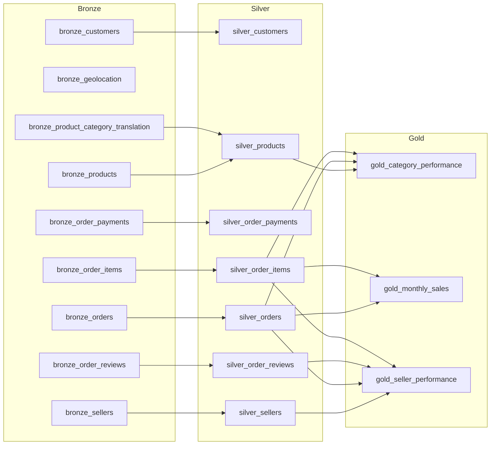

# Olist Medallion Pipeline

A bronze/silver/gold lakehouse-style pipeline on ~100k real Brazilian e-commerce orders, built with dbt and DuckDB.

[](https://github.com/Oppen-OC/olist-medallion-dbt/actions/workflows/ci.yml)


[](LICENSE)

**[Browse the live dbt docs and interactive lineage graph](https://oppen-oc.github.io/olist-medallion-dbt/)**

## Key insights

Computed from the gold layer; queries and full tables are in [VALIDATION.md](VALIDATION.md). Revenue is item price, freight excluded.

- **Trend:** revenue peaked in Nov 2017 (Black Friday) at 7,421 orders and $1.00M, then plateaued at roughly $0.84M-$0.99M per month through Aug 2018.
- **Top category:** `health_beauty` leads with $1.26M in revenue, despite a lower average ticket ($130.34) than `watches_gifts` ($200.70). Volume beats margin.
- **Sellers:** 9 of the top 10 sellers by revenue are in SP state. The highest-volume seller (1,804 orders) ranks only third on revenue and has one of the two weakest review scores in the top 10 (3.83).

## Architecture

Nine raw CSVs become bronze tables, silver cleans and conforms them, and gold aggregates them for analytics. Edges below are generated from dbt's `manifest.json`; column-level definitions are in [SCHEMA.md](SCHEMA.md).



`bronze_geolocation` is loaded but has no downstream models. `bronze_product_category_translation` is a lookup used only by `silver_products`.

## Stack

dbt-core 1.12, dbt-duckdb 1.11, DuckDB 1.5, Python 3.11 (pinned in [requirements.txt](requirements.txt)).

## Quickstart

```bash
git clone https://github.com/Oppen-OC/olist-medallion-dbt.git
cd olist-medallion-dbt

# create and activate a virtual environment
python -m venv .venv
.venv\Scripts\activate           # Windows
source .venv/bin/activate        # macOS / Linux

pip install -r requirements.txt
```

Download the dataset from [Kaggle](https://www.kaggle.com/datasets/olistbr/brazilian-ecommerce) and extract it into `data/raw/` (gitignored):

```bash
mkdir -p data/raw
unzip brazilian-ecommerce.zip -d data/raw          # Linux
tar -xf brazilian-ecommerce.zip -C data/raw        # Windows 10+ / macOS
```

Build everything and browse the docs. `profiles.yml` ships in the repo, so no `~/.dbt` setup is needed.

```bash
dbt build
dbt docs generate && dbt docs serve
```

## Project structure

```
.
├── models/
│   ├── bronze/          # 9 models, 1:1 with raw CSVs
│   ├── silver/          # 7 models: dedup, filter, type, enrich
│   └── gold/            # 3 models: business aggregates, enforced contracts
├── tests/               # singular tests (composite keys, revenue reconciliation)
├── analyses/            # queries behind VALIDATION.md
├── docs/                # static dbt docs (GitHub Pages) and the exercise statement
├── .github/workflows/   # CI: dbt parse
├── data/raw/            # Olist CSVs (gitignored)
├── SCHEMA.md            # schema and metric definitions
├── VALIDATION.md        # validation queries and outputs
├── dbt_project.yml
├── profiles.yml
└── requirements.txt
```

## Data quality

`dbt build` runs 19 models and 45 data tests (64 PASS on the latest run):

- `unique` and `not_null` on every primary key
- `accepted_values` on order status and review score
- 6 `relationships` tests covering the silver foreign keys
- 2 composite-key tests: `(order_id, order_item_id)` and `(order_id, payment_sequential)`
- A gold-to-silver revenue reconciliation test, so gold totals match silver item prices
- Enforced dbt contracts on all 3 gold models (column names and types are checked at build time)

## Design decisions

- **Revenue is item price, excluding freight.** Freight is a pass-through cost, not merchandise revenue.
- **Canceled orders are excluded from gold.** Silver keeps them so the history stays complete.
- **Silver deduplicates with `row_number()` or `qualify`** on each table's natural key.
- **Geolocation stays in bronze.** It has about 1M rows for 19k zip prefixes, so a join would fan out rows, and no current metric needs it.
- **Everything is a table.** The dataset is small, so a full rebuild takes seconds.

## Next steps

- Incremental models for the large fact tables
- Orchestration (Dagster or Airflow) instead of manual `dbt build`
- Run `dbt build` in CI against a small data sample, not only `dbt parse`
- Delivery-time metrics using geolocation

## Context

Built for the Enterprise Data & AI Architectures course (Master's in AI & Big Data, UPV). The assignment is in [docs/exercise-statement.md](docs/exercise-statement.md).

## License

Code is released under the [MIT License](LICENSE). The Olist dataset is licensed CC BY-NC-SA 4.0 and is not redistributed in this repo.
